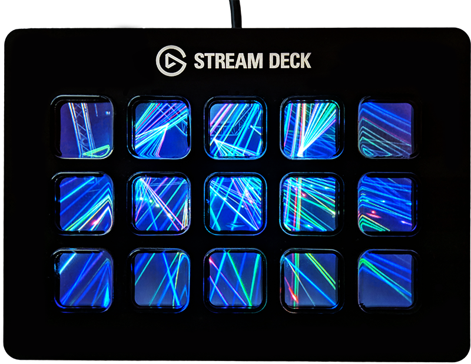
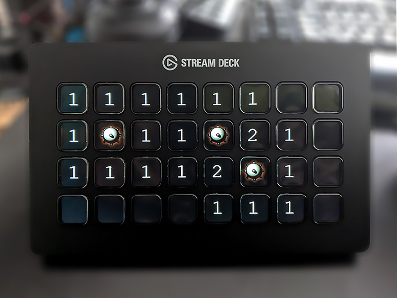

-----------------

**StreamDeckSharp is a simple (unofficial) library (.NET 10+) for the [Elgato Stream Deck](https://www.elgato.com/en/gaming/stream-deck) family**

[](LICENSE.md)
[](https://github.com/OpenMacroBoard/StreamDeckSharp/releases)
[](https://www.nuget.org/packages/StreamDeckSharp/)
[](AI-DISCLOSURE.md)

First things first, StreamDeckSharp is not official software by Elgato, nor is it endorsed by them.

StreamDeckSharp is a device provider implementation for [`OpenMacroBoard.SDK`](src/OpenMacroBoard.SDK).
The SDK itself is device-neutral: it defines the common types for macro boards, and other boards can be supported by writing a provider for it.
Both live in this repository, see [What is in this repository](#what-is-in-this-repository).

## AI Disclosure

I recently started to use AI to help me maintain this project.
For more about that, see [AI-DISCLOSURE.md](AI-DISCLOSURE.md).

## Quick Start

Create a new console project in Visual Studio (.NET 10+), add [`OpenMacroBoard.SDK`](https://www.nuget.org/packages/OpenMacroBoard.SDK/) as a reference and at least one device provider.

In this example we use

- [`OpenMacroBoard.SocketIO`](https://www.nuget.org/packages/OpenMacroBoard.SocketIO/) to support the `VirtualMacroBoard`
- [`StreamDeckSharp`](https://www.nuget.org/packages/StreamDeckSharp/) to support the [Elgato Stream Deck family](https://www.elgato.com/de/de/s/welcome-to-stream-deck)  
  <sub>_**Note**: Neither OpenMacroBoard nor StreamDeckSharp are made or endorsed by Elgato_</sub>

Once you added the NuGet packages copy-paste the following lines:

```csharp
using OpenMacroBoard.SDK;
using OpenMacroBoard.SocketIO;  // for VirtualMacroBoard
using StreamDeckSharp;          // for StreamDeck

// create a device context (fluent API)
// and add listener for devices (device provider)
using var ctx = DeviceContext.Create()
    .AddListener<SocketIOBoardListener>()   // VirtualMacroBoard
    .AddListener<StreamDeckListener>()      // StreamDeck
    ;

Console.WriteLine("Waiting for a device... (press Ctrl+C to cancel)");
using var board = await ctx.OpenAsync();
Console.WriteLine("Device found.");
Console.WriteLine("1) Try to press some buttons on the device.");
Console.WriteLine("2) Press any key in this console to end the demo.");

// react to key press event by setting a random color
board.KeyStateChanged += (sender, arg) => board.SetKeyBitmap(arg.Key, GetRandomColorKey());

// Wait for a key press in the console window to exit
// the application and disconnect the device.
Console.ReadKey();

// Helper function to create a random color KeyBitmap
static KeyBitmap GetRandomColorKey()
{
    var r = GetRandomByte();
    var g = GetRandomByte();
    var b = GetRandomByte();

    return KeyBitmap.Create.FromRgb(r, g, b);
}

// Helper function to get a random byte
static byte GetRandomByte()
{
    return (byte)Random.Shared.Next(255);
}
```

Here is what the example looks like after pressing some keys:


## Supported devices

NuGet: [`StreamDeckSharp`](https://www.nuget.org/packages/StreamDeckSharp/)

| Device                                                                | Description |
| --------------------------------------------------------------------- | ----------- |
| Stream Deck _(original/legacy)_                                       | 5 x 3       |
| [Stream Deck](https://www.elgato.com/de/gaming/stream-deck) _(MK2)_   | 5 x 3       |
| [Stream Deck XL](https://www.elgato.com/ww/de/p/stream-deck-xl)       | 8 x 4       |
| [Stream Deck Mini](https://www.elgato.com/de/gaming/stream-deck-mini) | 3 x 2       |

Keep in mind that Elgato sometimes releases new revisions of their devices with different PIDs (USB product IDs) which might break compatibility. If you have a device like that, please open an issue on GitHub with the new PID.

## Examples

You can find a lot of examples in the [examples](examples) folder.


### Fullscreen images


### Play games
Play games on a macro board, for example minesweeper (also part of the example projects)


### Videos
[](http://www.youtube.com/watch?v=tNwUG0sPmKw)  
_\*The glitches you can see are already fixed._


## What is in this repository

| Folder | Content |
| ------ | ------- |
| [`src/OpenMacroBoard.SDK`](src/OpenMacroBoard.SDK) | The device-neutral base library: common types and logic for macro boards. Implements no device itself. |
| [`src/StreamDeckSharp`](src/StreamDeckSharp) | Device provider for the Elgato Stream Deck family. |
| [`src/OpenMacroBoard.SocketIO`](src/OpenMacroBoard.SocketIO) | Device provider for boards that are reached over the network, like the virtual board. |
| [`src/OpenMacroBoard.VirtualBoard`](src/OpenMacroBoard.VirtualBoard) | A virtual macro board, to develop without hardware. |
| [`src/OpenMacroBoard.SDK.KeyBitmap.GDI`](src/OpenMacroBoard.SDK.KeyBitmap.GDI) | Helpers to create key bitmaps with GDI+ (Windows only). |
| [`examples`](examples) | Example and showcase projects. |
| [`tests`](tests) | Test projects. |

## Building

With Docker, no .NET SDK is needed. This builds everything and runs the tests:

```
docker build .
```

To create NuGet packages for local testing in `output/packages` (nothing is published, and the packages get a local pre-release version):

```
docker build --target packages --output type=local,dest=output/packages .
```

Without Docker you need the .NET 10 SDK:

```
dotnet build StreamDeckSharp.sln
dotnet test StreamDeckSharp.sln
```

A few projects target Windows. On Linux and macOS use the commands from the [Dockerfile](Dockerfile), which also lists more options.


---
 
###### This project is not related to *Elgato Systems GmbH* in any way

---