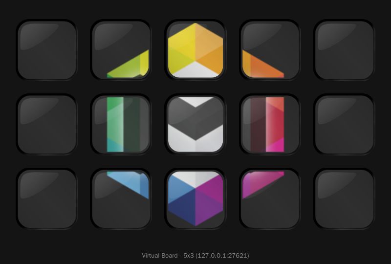
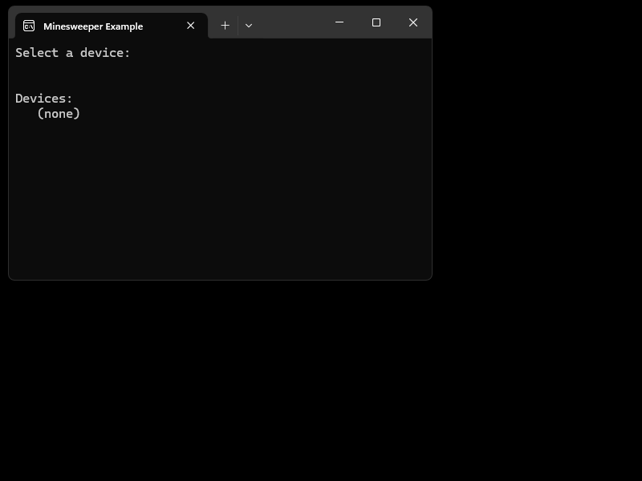

# Virtual Board
Virtual Board is a virtual macro board that allows developers to test software that targets `IMacroBoard`s from the `OpenMacroBoard.SDK` without any actual hardware.

To connect a virtual board you have have to first register the SocketIO device provider (see [homepage](https://openmacroboard.github.io/) "Quick Start" section).
Once you launch `VirtualBoard` it connects to the SocketIO device driver and you can use it like any other macro board.
You can even simulate disconnects and reconnects by stopping and starting the application.

VirtualBoard is a small web application that runs on Windows, Linux and macOS. It shows the board on a page
that you open in a browser. Start it from the root of the repository:

```
dotnet run --project src/OpenMacroBoard.VirtualBoard
```

It prints the address of the page, `http://127.0.0.1:28621/` by default. Without any CLI parameters, the device
starts to listen on port `27621` (binds locally to `127.0.0.1:27621`)
and with a classical Stream Deck configuration (5x3 keys, 72px square keys, 25px gap) and looks a bit like so



Once you started some application that uses `IMacroBoard`s (for example the [Minesweeper](../../examples/OpenMacroBoard.Examples.Minesweeper) example)
you can use it just by clicking with your mouse. Touch works too, with several fingers at once.

The page can be open in several tabs or browsers at the same time. A key is down as long as any of them holds it.



## CLI Parameters
There a few things you can configure with the VirtualBoard application with some CLI parameters (they are all optional)

| Parameter&nbsp;&nbsp;&nbsp;&nbsp;&nbsp;&nbsp;&nbsp;&nbsp;&nbsp;&nbsp;&nbsp;&nbsp;&nbsp;&nbsp;&nbsp;&nbsp;&nbsp;&nbsp;&nbsp;&nbsp;&nbsp;&nbsp;&nbsp;&nbsp;&nbsp;&nbsp;&nbsp;&nbsp; | Default&nbsp;&nbsp;&nbsp;&nbsp;&nbsp;&nbsp;&nbsp;&nbsp;&nbsp;&nbsp;&nbsp;&nbsp;&nbsp;&nbsp;&nbsp;&nbsp;&nbsp;&nbsp;&nbsp; |Description |
| --- | --- | --- |
| `--port <number>` | `27621` | The port number used by VirtualBoard.<br>Port numbers are used to distinguish between boards. There can only be one instance running with a given port, but you can run multiple instances with different board sizes on different ports so simulate multiple devices.  |
| `--web-port <number>` | `--port` plus 1000 (`28621`) | The port of the page that shows the board. |
| `--device-name <name>` | `Virtual Board - 5x3` | The name that is shown on the page and used for the macro board device name in `OpenMacroBoard.SDK` |
|`--keysx <count>`| `5` | Key count in X direction (columns) |
|`--keysy <count>` | `3` | Key count in Y direction (rows) |
|`--keysize <size>`| `72` | Image size for keys in pixels. |
|`--keygap <size>`| `25` | Gap between keys in pixels. |
| `--binding <ip>` | `127.0.0.1` | The binding IP address, for the board and for the page.<br>Theoretically you could bind to `0.0.0.0` to even run the virtual device on a different device (on the same network), but I haven't really tested that and there is no support/guarantee that this works.
| `--hide-ip-titlebar` |  | Hides the IP (and port) of the board on the page |
| `--open-browser` |  | Opens the page in the default browser after the start |

## Protocol between the server and the page
The page is one HTML file with plain JavaScript. It talks to the server through a WebSocket at `/ws`.
The protocol is small on purpose, so other front ends are possible.

Server to page, as JSON text messages:

| Message | Meaning |
| --- | --- |
| `{"type":"board","deviceName":"...","endpoint":"127.0.0.1:27621","countX":5,"countY":3,"keySize":72,"gapSize":25,"brightness":100}` | Always the first message. Describes the board. `endpoint` is `null` with `--hide-ip-titlebar`. |
| `{"type":"keyState","key":3,"down":true}` | A key went down or up, by this page or by another one. |
| `{"type":"brightness","percent":80}` | The application changed the brightness. |

Server to page, as binary message: the image of one key. All numbers are little endian.

| Bytes | Content |
| --- | --- |
| 1 | Message type, always `1` |
| 2 | Key ID |
| 2 | Width in pixels |
| 2 | Height in pixels |
| width × height × 4 | Pixels as RGBA, row by row. Width and height `0` mean a black key. |

After the `board` message the server sends the image of every key, and then again whenever one changes.
A page that is too slow skips images, it never falls behind.

Page to server, as JSON text message:

| Message | Meaning |
| --- | --- |
| `{"type":"key","key":3,"down":true}` | This page holds or releases a key. Keys a page still holds are released when its connection ends. |

Requests from other websites are refused: the server only answers requests that are addressed to an IP address,
to `localhost` or to the name of the machine, and that come from its own page.
